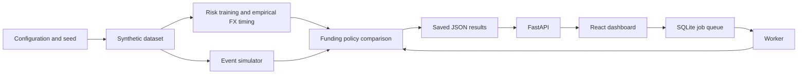

# T+1 Settlement and FX Funding Risk Engine

A local research application for exploring why securities trades miss settlement deadlines and how funding decisions affect those outcomes. It creates synthetic trades, simulates their settlement and FX cash flows, estimates observable risk, and compares funding policies. A dashboard makes the results easy to inspect.

**This is a research demo.** Its trades, operational behavior, and costs are synthetic; reference FX prices and selected holiday calendars come from published sources. It does not move money, book FX, or send settlement instructions.

## Why this project exists

A securities purchase creates an obligation to pay by a deadline. Under T+1, settlement is due on the next eligible business day. A trade can miss that deadline because its instructions are incomplete, its settlement details disagree, or the required cash arrives late. A funding team must decide where to place a limited cash reserve before those failures occur.

This project recreates that decision in a controlled experiment. For example, a trade owes USD 10,000 tomorrow, but its incoming FX cash may arrive late. The simulator records what the operator knew at the decision time, the risk model estimates failure under a reference funding policy, and the optimizer proposes reserve allocations. The simulator then replays the outcome for each policy so you can compare failures and costs.

It is useful for learning settlement operations and researching whether forecasts improve funding decisions. The generated trades and outcomes are synthetic. Online exchange rates provide dated valuation references; they do not make this a live trading system.

## What you can do

- **Review trades:** see model failure probabilities, funding gaps, deadlines, instruction status, and later outcomes. Rule scores remain in model evaluation as a research baseline.
- **Compare funding policies:** allocate a shared liquidity budget and inspect failures and realised costs across matched runs.
- **Study models:** generate larger datasets, train risk and FX timing models, and inspect their evaluation reports.
- **Reproduce results:** use seeded inputs, immutable artifacts, and a separate worker for funding jobs.

## Run the demo

You need Python 3.11–3.14, [uv](https://docs.astral.sh/uv/getting-started/installation/), Node.js 22.12+, and npm. On macOS, install XGBoost's OpenMP runtime with `brew install libomp`.

```sh
git clone https://github.com/26PB27-Final-Year-Project/t1-fx-risk.git
cd t1-fx-risk
uv sync --extra parquet --extra ml
npm ci --prefix frontend
npm run build --prefix frontend
.venv/bin/python -m t1fx.cli bootstrap
```

`bootstrap` generates training data from an earlier period, trains the risk and FX timing models, and publishes five funding-policy runs. Use `demo` for a quick replay without training. The quick `demo` publishes four funding-policy runs for **50 seeded synthetic trades across the last 30 calendar days (business-day executions)**. The watchlist includes only trades executed by the evaluation time; expand Monthly trade schedule to see all planned dates. Use the evaluation calendar, local time, and one of 38 IANA timezones to submit a new evaluation through the worker. Evaluation is limited to today or earlier within the run’s period, using an online-synchronized UTC clock. The calendar needs internet access to synchronize; deadline countdowns use hours and days. To choose another sample, use `demo --trades 40 --seed 7`. The small three-trade fixture in `configs/scenarios/three-trades.json` remains available for hand-checking the engine.

Start the app and worker in separate terminals:

```sh
.venv/bin/python -m t1fx.cli serve
```

```sh
.venv/bin/python -m t1fx.cli worker
```

Open **<http://127.0.0.1:8000/>** for the dashboard or **<http://127.0.0.1:8000/docs>** for the API. If a saved URL still opens an older run, return to the root URL or select the current rolling USD demo in **Simulation run**.

The dashboard has four views: **Trades** for individual cases, **Funding** for reserves and budget changes, **Scenarios** for policy comparisons, and **Model health** for trained-model reports. Recomputing funding requires the worker process.

Funding comparisons obtain reference rates in the settlement currency from [Frankfurter](https://frankfurter.dev/) for currencies in a scenario. The exact rates and source URLs are saved in each run and exposed at `/api/v1/runs/{run_id}/fx-rates`; recomputations reuse them. Frankfurter needs an internet connection to obtain rates for foreign funding sources. Its daily mid-market rates value results and budgets; generation also uses dated Frankfurter prices, with no fixed-price fallback. Source amounts are rounded up to the funding currency’s minor unit. Each generated FX leg saves its quote, observation date and source URL. Generation uses the preceding date’s published reference to avoid same-day publication lookahead. These are daily reference prices, not executable intraday quotes.

The default research generator includes EUR, CAD, GBP, JPY, and INR funding routes into USD settlement pools. The Funding page shows the saved reference value for each currency used by a run. Generated settlement trades and funding budgets use USD. Retrain risk and timing models on the new dataset; old model bundles describe the previous feature schema and FX routes.

## Calendar coverage and data sources

The default configuration pins a **2026–2028** calendar snapshot from [NYSE](https://www.nyse.com/trade/hours-calendars), [Federal Reserve Financial Services](https://www.frbservices.org/about/holiday-schedules/), and [ECB/TARGET](https://www.ecb.europa.eu/ecb/contacts/working-hours/html/index.en.html). NYSE early closes shorten the generated trading session; they do not change the assumed settlement cutoff. The simulated securities settlement calendar excludes both exchange and USD payment holidays. This is a documented research approximation, not a complete DTC rulebook.

USD and EUR payment holidays are sourced. CAD, GBP, JPY, and INR calendars, route lags, booking cutoffs, and settlement windows remain explicit scenario assumptions. Dates outside coverage fail instead of inventing holidays. FX reference prices use the online API described above; holidays use versioned official snapshots because a general public-holiday API is not a settlement calendar. Saved dataset configuration includes the dates and source URLs needed to reproduce a run.

## Generate research data

The demo is intended for exploration. Use the dataset generator for model training and experiments:

```sh
.venv/bin/python -m t1fx.cli generate --config configs/generation/smoke.json --format both
.venv/bin/python -m t1fx.cli validate-dataset --dataset DATASET_ID
.venv/bin/python -m t1fx.cli train --dataset DATASET_ID
.venv/bin/python -m t1fx.cli train-timing --dataset DATASET_ID
```

The generator prints `DATASET_ID`; training prints model IDs. The smoke configuration starts on 6 July 2026 so that its partitions and recovery gaps use historical FX observations. Use `generate --start-date YYYY-MM-DD` to choose another open trading date within calendar coverage; leave enough time for every partition and recovery gap to finish before today. The smoke configuration creates 1,000 trades across dated training and evaluation partitions. FX arrivals are sampled as 20% early, 30% exactly at the expected time, 45% late (1–240 minutes), and 5% unresolved within the simulation. These configurable probabilities are research assumptions, not measured bank statistics; individual samples will vary. Early means earlier than the expected FX receipt, not necessarily before the securities deadline. The default T+2 FX route deliberately exposes a mismatch with T+1 securities settlement. Hidden arrival draws never enter the model's observable inputs. Data and runs are stored under `artifacts/`. For other commands and model compatibility rules, see the guides below.

## First walkthrough: what to inspect

1. Open **Trades**, select the trailing-30-day USD run, and expand the monthly schedule. The schedule contains 50 trades; the watchlist only shows trades executed by the selected evaluation time. Fewer visible rows early in the month are expected.
2. Select an available probability model. Open a trade to inspect its instruction state, settlement details, cash observations, deadline, and model explanation. A probability is an estimate, not a guarantee. Settled or expired trades may show **Not applicable**.
3. Open **Funding**, select the empirical timing model, set a budget such as USD 15,000, and submit a recomputation. Keep the worker terminal running. Wait for the job to complete and select its resulting run.
4. Open **Scenarios** and compare the five policies from the same comparison. Record failures, failed notional, funding allocations, and realised costs. Equal results are possible when instruction problems or late receipts dominate the experiment.
5. Open **Model health** to examine risk and timing evaluation. Record the dataset/model IDs alongside metrics. Strong synthetic performance is not evidence of accuracy on real bank data.
6. Change the evaluation date/time only within the saved simulation and no later than today. The timezone selector has 38 supported named zones. Online time synchronization requires internet access.

Stop the API and worker with **Control-C** in their respective terminals. The API serves the built frontend, so a separate frontend development server is unnecessary for this walkthrough.

## How the system works



- **Dataset generation:** a seed controls random trade sizes, delays, and injected operational problems. Whole days are assigned to training, tuning, calibration, and test partitions, with gaps for label maturity. Hidden generation truth is kept separate from observable model inputs.
- **Simulation:** events advance a simulated clock. Instructions, cash receipts, FX, reservations, and deadlines determine whether each whole trade settles. An evaluation time reconstructs what was observable then; it is not a continuously streaming market feed.
- **Risk prediction:** logistic regression and XGBoost learn from observable features. Tuning selects candidates; a separate calibration cohort adjusts probabilities; the final test cohort measures performance. Rule scores are a transparent comparison baseline in evaluation.
- **Explanation:** native XGBoost Tree SHAP attributes the raw model log-odds to features. Contributions do not add directly to the calibrated percentage and are not causal explanations.
- **Timing forecasts:** an empirical distribution of observed FX receipt delays produces possible arrival scenarios. Shared shocks are an explicit dependence assumption, not a learned correlation.
- **Funding:** fixed zero/half/full reserve policies and two linear-program policies compete under a shared budget. The deterministic LP uses expected receipts; scenario LP considers sampled arrivals. The planning objective differs from independently measured replay costs. No policy is guaranteed to win.

Risk predictions describe the **fixed-zero funding reference policy**, even when viewing another policy's run. They do not estimate the effect of the newly chosen funding allocation.

## Data, storage, and API

| Item | Location / format | Meaning |
| --- | --- | --- |
| Training dataset | `artifacts/datasets/DATASET_ID/` | Typed JSON tables, optional Parquet, scenarios, configuration, provenance and data card |
| Risk model | `artifacts/models/MODEL_ID/` | JSON model artifacts, preprocessing, calibration, feature schema, metrics and model card |
| Timing model | `artifacts/timing_models/` | Empirical timing distributions and evaluation reports |
| Simulation run | `artifacts/runs/RUN_ID/` | Scenario, observations, funding decisions, outcomes, metrics and checksums |
| Latest bootstrap summary | `artifacts/demo-summary.json` | Dataset, model and comparison identifiers |
| Background jobs | SQLite under `artifacts/` | Durable job status, ownership and result references |

Timestamps are timezone-aware UTC. Financial inputs use integer minor units: EUR 100.25 is 10025 cents; JPY has no fractional minor unit. API amount fields use decimal strings where defined to avoid floating-point loss. IDs join trades, counterparties, FX legs, cash pools, scenarios and model outputs. Manifests/checksums detect changed artifacts; do not edit generated bundles in place.

The API returns JSON. Explore the exact schemas interactively at `http://127.0.0.1:8000/docs`. Useful routes include `/health/ready`, `/api/v1/runs`, `/api/v1/models`, `/api/v1/runs/{run_id}/trades`, `/api/v1/runs/{run_id}/metrics`, and `/api/v1/runs/{run_id}/fx-rates`. A funding recomputation returns a job reference; poll `/api/v1/jobs/{job_id}` until it finishes.

## Verify the installation yourself

Run these from the repository root after setup:

```sh
.venv/bin/python -m pytest
npm run build --prefix frontend
cd frontend
npx playwright install chromium
cd ..
npm run test:e2e --prefix frontend
```

Backend tests cover simulation invariants, datasets, model fitting, explanations, APIs, jobs and clean bootstrap. Browser tests use an isolated temporary server on port 8765; they exercise navigation, themes, calendar constraints and recomputation. Tests use controlled exchange-rate/time fixtures, so they do not prove the live external providers are available.

Validate your own generated outputs using IDs printed by bootstrap (replace the uppercase placeholders):

```sh
.venv/bin/python -m t1fx.cli validate-dataset --dataset DATASET_ID
.venv/bin/python -m t1fx.cli validate-model --model MODEL_ID
.venv/bin/python -m t1fx.cli validate-timing --model TIMING_MODEL_ID
.venv/bin/python -m t1fx.cli validate --run RUN_ID
```

## Research experiments and presentation evidence

The quick `demo` skips training and produces four policies. `bootstrap` executes the implemented training and five-policy workflow. Neither command automatically completes a publishable research study.

For a study, generate multiple seeds and larger day cohorts, train only on historical partitions, and evaluate on untouched later scenarios. Use the same scenario, budget, rates and forecast settings across policy comparisons. Keep each generated configuration and manifest. Replaying saved scenarios is more reproducible than relying on the rolling demo, whose dates change each day.

Report risk PR-AUC (average precision), ROC-AUC, Brier score, log loss and reliability; report timing Brier score/reliability; report funding failures, exposure, costs and budget use. Brier score and log loss are better when lower. AUC metrics are better when higher but do not demonstrate calibration. Report uncertainty by scenario day rather than treating snapshots of one trade as independent observations. The default smoke dataset has only two final test days, which is insufficient for strong generalization claims.

For a review, save screenshots of a trade explanation, the matched policy table, model health, and a completed worker job. Accompany them with the dataset/model/run IDs, seed, configuration, evaluation timestamp, currency, and underlying JSON metrics. Clearly label synthetic results and separate implemented features from the limitations below.

## Troubleshooting and fresh runs

| Symptom | Action |
| --- | --- |
| `No module named sklearn` or `xgboost` | Run `uv sync --extra ml --extra parquet`; use `.venv/bin/python` for commands after installation. Bare `uv sync` does not request the optional ML packages. |
| macOS cannot load `libomp` | Run `brew install libomp`, then retry. |
| Dashboard missing or old | Run `npm ci --prefix frontend` and `npm run build --prefix frontend`, restart the API, then reload the root URL. |
| Job stays queued | Start the worker from the same repository with the same artifacts directory as the API. |
| No compatible model | Run bootstrap; select its run and model. Currency, feature schema and calibration maturity must match. |
| Missing probabilities | Quick demo does not train a model; settled/expired rows are not scored. |
| Date unavailable | Dates must be inside this run and not in the future. Create a new monthly run if using an old saved run. |
| Time or FX provider error | Check internet access and retry. Reference rates are daily observations, so weekends may use the preceding published date. |
| Port 8000 in use | Stop the earlier server or use `serve --port 8001`, then open that port. |

Bootstrap does **not** erase old results. For an independent clean workspace without deleting evidence, use a new directory consistently:

```sh
.venv/bin/python -m t1fx.cli --artifacts artifacts-review bootstrap
.venv/bin/python -m t1fx.cli --artifacts artifacts-review serve
# In another terminal, from the same repository:
.venv/bin/python -m t1fx.cli --artifacts artifacts-review worker
```

Keep generated data out of Git. Reusing the same inputs can reuse identical content-addressed artifacts; this is intentional.

## Scope and remaining work

Implemented: synthetic event simulation, dataset generation, calibrated risk models, SHAP, empirical timing forecasts, five funding policies, persistent results, local API/dashboard, background recomputation, sourced US/EUR holiday snapshots, varied receipt timing and held-out policy exports.

Remaining: validation on actual settlement data, a larger repeated experimental study, a separately calibrated timing classifier, fitted dependence, rolling treasury accounting, securities inventory/partial settlement/netting, external bank integration, and shared-host authentication/deployment. The current system assumes securities are available and models independent daily cash episodes. It is appropriate as a local final-year research prototype; a completion percentage requires an agreed list of assessed objectives.

See the [review findings and verification record](docs/review.md) for priorities and evidence.

## Project layout

| Path | Contents |
| --- | --- |
| `src/t1fx/` | Simulation, risk models, funding optimizer, API, jobs, and CLI |
| `frontend/` | React dashboard and browser checks |
| `configs/` | Scenario and dataset generation inputs |
| `artifacts/` | Generated datasets, models, and run results; ignored by Git |
| `docs/` | Detailed architecture, workflows, assumptions, and status |

## Documentation

- [Latest local verification and complete startup workflow](docs/verification.md)
- [Application and dashboard](docs/application.md)
- [Risk-model workflow](docs/models.md)
- [FX timing and scenario funding](docs/funding.md)
- [Implementation status and limitations](docs/implementation-status.md)
- [Architecture and design decisions](docs/architecture.md)

The current implementation is designed for one local operator. Generated settlement uses USD, securities availability is assumed, and model results on synthetic data do not establish real-world accuracy.


### Evaluation and rate reproducibility

Trade evaluation date/time and timezone have separate controls. The timezone determines how the entered wall-clock time is interpreted. Generation anchors the rolling window to online time in New York; small samples spread across that window. New replays preserve scenario seed, count and common-shock weight. Older runs that did not save these fields use defaults.

New valuation snapshots use the preceding calendar date to avoid using a rate from later on the evaluation day. This is a conservative daily-date policy; the provider does not supply publication timestamps. Historical generation quotes are checksummed and cached under `artifacts/fx_cache/`, with three attempts on provider failure. To reproduce a study, retain saved scenarios and quotes.

Remaining research extensions: authoritative calendars for the remaining funding currencies and validated route conventions, larger independent test cohorts, rolling treasury balances, learned timing dependence, statistical policy-study intervals and authenticated shared deployment. These require declared experiment designs and external validation; passing software tests does not establish market realism.

Generated trade rows use short labels such as **Trade 1 · 2026-10-13**, **Sample equity 15**, and **Sample counterparty 8**. These are fictional display aliases, not real companies. Open a trade for a payment summary and expand **Research identifiers** for its canonical IDs. Search accepts both the readable labels and original IDs. Cash pools are shared; a pool balance is not a separate allocation to each trade.

## Export presentation evidence

After generating a dataset, run a matched policy experiment on its **test partition only**:

```sh
.venv/bin/python -m t1fx.cli experiment --dataset DATASET_ID --budgets 0 15000 30000
# Add the trained timing model to compare five policies and repeated forecast draws:
.venv/bin/python -m t1fx.cli experiment --dataset DATASET_ID --budgets 0 15000 30000 --timing-model TIMING_MODEL_ID --seeds 7 42 101
```

Open the printed directory under `artifacts/research/experiment-…/`:

- `report.html`: readable comparison table with links to the evidence files.
- `summary.csv`: mean failures and costs by budget and policy.
- `comparisons.csv`: every test day, forecast seed, policy, run ID, and savings versus no reserve.
- `trades.csv`: readable test trades, fictional security/counterparty aliases, payment amounts, deadlines, and funding currencies.
- `report.json` and `manifest.json`: complete results, settings, and file checksums.

Budgets are in settlement-currency major units (USD in the default config). Policies within a comparison share the same trades, outcomes and FX valuation snapshot. Existing run storage prevents identical runs from being overwritten. Timing training must end before every test scenario begins. Forecast seeds change arrival samples, **not the underlying trade dataset**; generate several independently seeded datasets and pass their IDs after `--dataset` to study data variation. Means are descriptive, not confidence intervals. Do not select model settings based on these held-out results and then report the same test data as an unbiased evaluation.
