# Architecture & Core Engine Design
## T+1 Settlement-Fail & FX Funding Risk Engine

Design version: 1.0 · 13 October 2026  
Source: `Build Plan T+1 Settlement-Fail & FX Funding Risk Engine.md`  
Status: implementation specification for a research/demo application. No application code is implemented by this document.

## 1. Product and implementation boundary

Build an application that answers three questions at a selected decision time:

1. Which outstanding securities trades are most likely to miss their contractual settlement deadline, and what observable factors explain that risk?
2. How much additional cash should be reserved in each settlement currency, given existing cash, expected receipts, timing uncertainty, and a shared liquidity budget?
3. When those recommendations are replayed, how do actual settlement failures and costs compare with simple funding policies?

The system is a simulator-backed decision-support tool. Funding recommendations are hypothetical; the application does not send payments, book FX, or transmit settlement instructions.

The supplied build plan references a separate PRD, including its schemas and experiments E1–E6. That PRD was not supplied. This document defines implementable replacements, and marks the proposed experiments accordingly.

### 1.1 Scope decisions

| Area | First vertical slice | Full project scope |
| --- | --- | --- |
| Securities | Cash equity purchases under a US T+1 profile | Additional explicitly configured market/instrument profiles |
| Currencies | USD settlement; EUR as an investor funding currency | USD and CAD settlement buckets, then further validated profiles |
| Participants | One simulated investment firm and configured counterparties | Multiple segregated cash pools; pooling only when explicitly permitted |
| Cash | Opening balances, externally funded FX receipts, securities debits, incremental bridge reserves | More receipt types and richer funding routes |
| FX | Configured pair-specific value dates and booking/credit delays | Holiday stress, missed booking cutoffs, additional pairs |
| Prediction | Rule baseline, then logistic regression and XGBoost | Calibration, SHAP, timing-risk model |
| Optimization | Deterministic requirement LP | Scenario-based requirement LP using FX timing uncertainty |
| Operating mode | Stored immutable runs | Replay with a simulated clock |
| Settlement | Whole-trade settlement; fixed deterministic payment priority | Partial settlement only as a separately designed extension |

Canada, India, the UK, Eurozone venues, and Japan must not inherit a universal T+1 rule. A market label alone does not define instrument coverage, settlement infrastructure, or currency calendars. Each added profile needs dated conventions and fixtures.

### 1.2 Corrections to the original plan

* A missed processing cutoff is an operational exception, not automatically a settlement failure. DTCC explicitly describes alternatives after its 9 p.m. ET affirmation cutoff. Model a fallback route, its time, and its additional cost. [DTCC affirmation guidance](https://www.dtcc.com/insights/2024/trade-affirmations-key-questions-answered-as-t1-approaches)
* Securities settlement cycles are instrument/profile rules. The SEC's T+1 rule has defined scope and exceptions; do not apply it to every security. [SEC T+1 FAQ](https://www.sec.gov/exams/educationhelpguidesfaqs/t1-faq)
* T+2 is a common FX convention, not a mandatory value date for all FX. CLS describes T+2, T+1, and T+0 activity. Store the contractual FX value date and the actual cash credit separately. [CLS settlement-cycle discussion](https://www.cls-group.com/insights/innovation/report-reimagining-same-day-fx-exploring-the-case-for-additional-settlement-cycles-shapingfx-series/)
* Securities processing, FX booking, and cash availability progress concurrently. They cannot be represented faithfully by one linear state sequence ending in `FX_BOOKED → FUNDED → SETTLED`.
* Total fail probability is not extra cash demand. `notional × (1 + risk_weight × fail_probability)` can fund a trade beyond its obligation and allocate cash to operational problems it cannot fix. Use a cash ledger plus timing scenarios instead.
* Failure injection rates and realised failure rates are different. Some injected problems are repaired; several may affect the same trade.
* A seed alone does not guarantee identical Parquet bytes. Canonical data hashes are the portability guarantee; byte identity additionally requires a pinned writer and environment.

## 2. Architecture

Use a modular monolith: one Python package, one API process, one worker process, and one React application. Keep domain engines independent of HTTP, the UI, and storage adapters.

```mermaid
flowchart LR
    CFG[Versioned configs and calendar profiles] --> SIM[Event simulator]
    SIM --> RAW[Events, trades and cash ledger]
    RAW --> SNAP[Point-in-time snapshots]
    SNAP --> FEAT[Feature builder]
    FEAT --> MODEL[Risk models and calibration]
    MODEL --> SCORE[Predictions and SHAP]
    RAW --> REQ[Cash requirement builder]
    SNAP --> REQ
    MODEL -->|FX timing model only| REQ
    REQ --> OPT[Funding LP]
    OPT --> POL[Immutable funding plan]
    POL --> REPLAY[Policy replay]
    RAW -->|Same exogenous scenario| REPLAY
    REPLAY --> EVAL[Realised outcomes and costs]
    RAW --> STORE[Run artifact repository]
    SCORE --> STORE
    POL --> STORE
    EVAL --> STORE
    STORE --> API[FastAPI query service]
    API --> UI[React dashboard]
    UI -->|Submit experiment or recompute| JOBS[Job registry]
    JOBS --> WORKER[Local worker]
    WORKER --> OPT
    WORKER --> REPLAY
```



### 2.1 Technology decisions

| Concern | Decision | Reason |
| --- | --- | --- |
| Runtime | Python 3.11 initially; exact dependencies in a lockfile | Matches the team's build plan |
| Simulation | Python `heapq`, typed event handlers, NumPy generators | Small deterministic engine with explicit ordering |
| Contracts | Pydantic for API/domain boundaries; explicit Arrow schemas | Runtime validation and stable datasets |
| Data | Parquet for immutable tables; DuckDB for filtered reads | Avoid loading every table for every API call |
| Mutable metadata | SQLite for runs, jobs, artifact paths, idempotency keys | Sufficient for a single-host research demo |
| ML | scikit-learn, XGBoost, SHAP; Optuna for tuning | Baselines, tabular model, attribution |
| Optimization | SciPy `linprog(method="highs")` | Continuous LP with solver status and sensitivities |
| Backend | FastAPI with a separate CLI worker | Long work survives HTTP request completion |
| Frontend | React, TypeScript, Vite, Recharts, generated API types | Matches the proposed UI stack |
| Packaging | Monorepo, CLI, Makefile, Docker Compose | Same workflow locally and in the demo |

Pin versions after a dependency compatibility smoke test. Do not copy unverified latest version numbers into the lockfile. SQLite is local to one host; distributed HPC tuning must use independent trial artifacts or a suitable shared database, not a concurrently written SQLite file on a shared filesystem.

### 2.2 Module ownership and dependency rules

| Module | Responsibility | Must not do |
| --- | --- | --- |
| `domain` | IDs, enums, money, timestamps, contracts | Import API, ML libraries, or persistence |
| `calendars` | Business dates, cutoff instants, settlement profiles | Infer a market's rules from its currency |
| `simulator` | Exogenous events, state transitions, ledger, outcomes | Reveal future events to a policy |
| `snapshots` | Reconstruct observable state at an `as_of` time | Include simulator latent variables |
| `features` | Shared offline/online feature transformations | Fit preprocessing on test data |
| `models` | Training, calibration, inference, SHAP | Write funding amounts |
| `funding` | Cash scenarios, requirements, optimization, policies | Treat total fail risk as causal funding benefit |
| `evaluation` | Matched replay and experiment reports | Compare policies with different budgets unnoticed |
| `storage` | Artifact I/O, hashes, query adapters | Define financial rules |
| `jobs` | Durable job state and worker orchestration | Run heavy work in HTTP handlers |
| `api` | Validate requests, query runs, submit jobs | Reimplement features or optimization |

`domain` is the shared dependency. Orchestration wires modules together using typed interfaces. Engine modules do not import the dashboard or FastAPI.

## 3. Identity, time, money, and provenance

These are non-negotiable implementation invariants.

1. A trade belongs to an immutable exogenous `scenario_id`. A `run_id` identifies one policy replay or processing run. IDs are deterministic within generated scenarios.
2. Every event has `event_time` and `available_at`. An observation is usable only if both are at or before `as_of`. This distinguishes when something happened from when the system learned it.
3. Store timestamps as timezone-aware UTC and market dates as dates. Resolve local cutoff times using IANA zones and versioned calendar profiles; never use a fixed UTC offset for New York.
4. Store monetary amounts as signed integer minor units with a currency. JPY and USD do not have the same minor-unit exponent. API amounts are decimal strings so JavaScript cannot silently lose integer precision.
5. Store rates as decimal strings with an explicit quote direction. `base_per_currency` means base-currency units per one whole unit of the named currency. Every conversion records `fx_rate_set_id` and valuation time.
6. Convert money to scaled floating-point values only at numerical-model boundaries. Round optimizer output back to minor units and revalidate all constraints.
7. `run_manifest.json` records input hashes, scenario/seed, code revision, environment/lock hash, schema, calendar, features, models, policies, rates, and optimizer configuration.
8. No model may use simulator truth such as hidden counterparty propensity, sampled future delays, injected corruption not yet detected, or final outcomes.

## 4. Data contract

Every persisted table has `schema_version`; run-scoped tables also have `run_id`. Keys and foreign keys are validated at release time. Nullable fields mean unknown/not applicable, never an implicit zero.

| Table and grain | Key fields and required content |
| --- | --- |
| `trades`: one securities trade | `trade_id`, `scenario_id`, `entity_id`, `cash_pool_id`, `counterparty_id`, `security_id`, `instrument_type`, `market_profile_id`, `side`, `quantity`, `price`, `settlement_currency`, `settlement_amount_minor`, `executed_at`, `trade_date`, `contractual_settlement_date`, `contractual_deadline_at`, `ssi_id` |
| `counterparties`: versioned observable reference record | `counterparty_id`, `version`, `region`, `valid_from`, `available_at`; observable reference attributes only |
| `ssi_versions`: one instruction version | `ssi_id`, `version`, `account_ref`, `currency`, `market_profile_id`, `valid_from`, `available_at`, `validation_status`; synthetic account references in demo |
| `fx_legs`: one FX contract | `fx_leg_id`, `entity_id`, `cash_pool_id`, `sell_currency`, `sell_amount_minor`, `buy_currency`, `buy_amount_minor`, `booked_at`, `value_date`, `expected_credit_at`, `funding_source_id`, `route_profile_id` |
| `trade_fx_allocations`: one obligation/FX allocation link | `trade_id`, `fx_leg_id`, `allocated_buy_amount_minor`; links cannot exceed the FX leg's buy amount |
| `events`: one immutable event | `event_id`, `trade_id?`, `fx_leg_id?`, `event_type`, `event_time`, `available_at`, `sequence`, `payload_version`, typed `payload` |
| `cash_flows`: one posted or scheduled account movement | `flow_id`, `cash_pool_id`, `currency`, `amount_minor`, `flow_type`, `effective_at`, `available_at`, `status`, `source_ref`; status distinguishes forecast, committed, and posted |
| `snapshots`: one trade at one decision time | `snapshot_id`, `run_id`, `trade_id`, `as_of`, `horizon_at`, `reference_policy_id`, observable lifecycle states, remaining cash need, observed cutoffs, freshness flags |
| `outcomes`: one trade per policy replay | `run_id`, `trade_id`, `missed_contractual_deadline`, `settled_at?`, `outcome_known_at`, `failure_reasons[]`, `recovered_late`, `cost_components`, `censored` |
| `predictions`: one model result per snapshot | `snapshot_id`, `model_bundle_id`, `p_fail_any`, `risk_band`, `reference_policy_id`, `horizon_at`, `scored_at`, `status` |
| `fx_timing_predictions`: one FX leg/credit target | `fx_leg_id`, `as_of`, `credit_target_at`, `p_credit_after_target`, `timing_model_id`, `scenario_method_version` |
| `explanations`: one feature contribution | `snapshot_id`, `model_bundle_id`, `feature_name`, `observed_value`, `shap_value`, `output_space`, `rank` |
| `funding_plans`: one immutable recommendation | `plan_id`, `source_run_id`, `as_of`, `window_id`, `input_hash`, `params_hash`, `status`, `solver_metadata`, `expected_cost_base`, `fallback_used` |
| `funding_allocations`: one bucket per plan | `plan_id`, `cash_pool_id`, `currency`, `existing_usable_minor`, `incremental_reserve_minor`, `expected_shortfall_minor`, `cap_minor`, `driver_trade_ids[]` |
| `experiments`: one policy/scenario/seed result | `experiment_id`, `scenario_id`, `seed`, `policy_id`, versions, realised metrics, runtime |

Simulator-only latent parameters and random draws live in a separate `simulation_truth/` artifact namespace. The feature builder has no adapter for reading it.

### 4.1 Minimal snapshot contract

```python
class TradeSnapshot(BaseModel):
    snapshot_id: str
    run_id: str
    trade_id: str
    as_of: datetime
    horizon_at: datetime
    reference_policy_id: str
    cash_pool_id: str
    currency: str
    settlement_amount_minor: int
    instruction_state: InstructionState
    settlement_state: SettlementState
    observed_ssi_status: SSIStatus
    minutes_to_affirmation_cutoff: float
    minutes_to_settlement_deadline: float
    remaining_obligation_minor: int
    reserved_cash_minor: int
    history_as_of: datetime
```

This is an interface sketch, not the complete Pydantic implementation. Add timezone, currency, nonnegative obligation, and horizon validators. Cash availability is account-level; a trade reservation must come from an explicit allocation, not a copy of the entire account balance.

## 5. Calendar and convention engine

Use separate profiles for securities markets, currency payment calendars, and FX routes. A route contains its booking timezone/cutoff, value-date convention, relevant calendars, expected credit-time rule, and transfer lead time.

```python
settlement_date(trade_date, market_profile, instrument_type) -> date
cutoff_at(business_date, cutoff_kind, profile_version) -> datetime
fx_value_date(booked_at, currency_pair, route_profile) -> date
earliest_funding_arrival(as_of, currency, route_profile) -> datetime
minutes_to_cutoff(as_of, cutoff_at) -> float
```

`minutes_to_cutoff` remains negative after the deadline; downstream code must not silently clamp it to zero. The simulator uses exact instants, not rounded UI countdowns.

Every rule record includes `effective_from`, `effective_to`, `source_url`, `retrieved_at`, and `classification = sourced | assumption | scenario_override`. Synthetic securities deadlines and FX credit times are valid demo inputs when visibly marked as assumptions. They must not be presented as official market deadlines.

The US starter profile may use 21:00 `America/New_York` on trade date for the referenced affirmation processing cutoff. Its fallback route and final settlement deadline are separate fields. DTCC describes missing that affirmation cutoff as recoverable through other processing routes. [DTCC affirmation guidance](https://www.dtcc.com/insights/2024/trade-affirmations-key-questions-answered-as-t1-approaches)

Essential fixtures: Friday execution; security-market holiday; one currency holiday; DST changes; execution after booking cutoff; a receipt after the securities deadline on the same date; early-close override; missing calendar data. Missing rules fail validation instead of silently substituting Monday–Friday.

## 6. Simulator core

### 6.1 Parallel state machines

| Track | States |
| --- | --- |
| Instructions | `EXECUTED → ALLOCATED → CONFIRMED → AFFIRMED → INSTRUCTED` |
| SSI | `UNKNOWN → VALIDATING → VALID` or `MISMATCH → REPAIR_PENDING → VALID` |
| FX leg | `NOT_REQUIRED` or `UNBOOKED → BOOKED → CREDIT_PENDING → CREDITED` |
| Cash | Ledger-derived available/reserved/consumed amounts; not a single trade-wide boolean |
| Settlement | `PENDING → READY → SETTLED`; deadline may set `FAILED_AT_DEADLINE`; later completion sets `SETTLED_LATE` |

`missed_contractual_deadline` remains true after late recovery. Operational failure reasons are multi-label and are assessed from blockers at the deadline. Cancellation and invalid input are separate from failure labels.

An FX credit is not required if usable existing cash or an eligible reserve already covers the obligation. Conversely, booked FX is not posted cash.

### 6.2 Event ordering

Heap key: `(event_time_utc, phase_priority, stable_sequence, event_id)`.

At a timestamp, apply external credits and prerequisite completions first, then funding decisions, then settlement attempts, then deadline evaluation, and finally scheduled reporting snapshots. Set the profile convention to allow prerequisites completed exactly at the deadline (`<=`); include boundary tests. Do not let a newly scheduled event move backward into an already completed phase at the same timestamp.

```python
while queue:
    event = pop_next_event(queue)
    clock.advance_to(event.event_time)
    handler(event).apply(state, ledger)
    append_event(event)
    schedule_valid_followups(event, state, queue)
```

Observation delays create later knowledge-update events. Physical settlement and recorded knowledge can therefore differ without leaking the physical truth into decisions.

### 6.3 Randomness and replay

Generate an exogenous scenario independently of policy decisions. Use stable random streams keyed by `(master_seed, scenario_id, entity_id, mechanism, occurrence)` with a stable hash/seed derivation, not Python's process-dependent `hash()`.

A different funding policy must not consume a different sequence of affirmation/SSI/FX-delay random draws. New policy-dependent actions use separate streams. Persist either sampled exogenous events or their deterministic keys.

Funding policy receives only `DecisionContext(as_of, observable_snapshots, observable_ledger, conventions)`. It never receives the future queue or truth store.

### 6.4 Cash ledger and settlement

For each legally usable pool and currency:

```text
posted_balance = opening_cash + posted_credits - posted_debits
free_cash      = posted_balance - active_reservations
```

Reserving cash reduces free cash, not posted balance. Settling a reserved trade releases its reservation and debits the posted balance atomically. All ledger operations have unique idempotency keys.

Do not reuse the same receipt across multiple trades or combine unrelated accounts. In the first version, all eligible purchases in a currency share one explicitly configured pool. Trade settlement order is fixed across policies: deadline, execution time, trade ID. If the next trade cannot settle in full, follow a configured skip-or-block rule; choose `skip_unfunded` for v1 and persist the choice.

The initial FX adapter treats buy-currency receipts as externally funded by an explicit source-currency commitment. It records that commitment, validates source capacity, and excludes it from the incremental bridge budget. A receipt cannot appear without a funding source. Full two-currency treasury optimization is deferred.

At each attempt, require valid instructions/SSI, any modeled securities availability, an open route, and sufficient spendable cash. The first release assumes securities are available and states this in its data card.

### 6.5 Failures and realised costs

Inject late instructions, FX delays/cutoff misses, SSI problems, and funding stress as mechanisms. Record separately: injection, observable detection, repair, and deadline blocker. Never add arbitrary outcome noise merely to reduce model AUC; represent uncertainty through mechanisms and incomplete observations.

Compute costs from intervals and postings:

```text
cash_carry_cost = sum(idle_reserved_amount × annual_rate × elapsed_days / day_count)
bridge_cost    = sum(drawn_outstanding_amount × annual_rate × elapsed_days / day_count)
late_cost      = sum(overdue_obligation × daily_penalty_rate × elapsed_days)
total_cost     = cash_carry_cost + bridge_cost + late_cost + route_fees
```

Use mutually exclusive idle/drawn intervals for a reserve so carrying cost is not counted twice. Day count and penalty accrual conventions are configuration fields. All demo penalties and funding rates are labeled assumptions unless sourced. Principal transfers are not expenses.

Continue replay through a configured recovery horizon. Flag unresolved trades as censored, report overdue exposure and accrued cost through that horizon, and do not invent a final settlement time. Refund/release unused reserve and account for bridge repayment explicitly at the end of the funding window. Repayment requires actual available cash; unrepaid draws remain outstanding, accrue costs, and consume capacity in the next window. A window boundary never creates repayment cash.

## 7. Snapshot, feature, and label engine

### 7.1 Decision schedule

Start with one snapshot at the end of trade day and one before the final funding action cutoff. Add other sessions as configuration. A decision is eligible only when it precedes the prediction horizon and the proposed action can arrive in time.

All features use events with `event_time <= as_of` and `available_at <= as_of`. Historical outcomes also require `outcome_known_at <= as_of`. Excluding the current trade alone is insufficient.

### 7.2 Features

| Group | Initial features |
| --- | --- |
| Timing | Minutes to each cutoff, trade age, observed stage age, booking window remaining, local session |
| Instructions | Allocation/confirmation/affirmation flags, observed SSI validation result, repair pending |
| Cash and FX | Remaining obligation, explicitly reserved amount, pool coverage, FX booked flag, contractual value-date gap, expected credit gap |
| Counterparty history | Lagged known-outcome fail rate, observed delay quantiles, sample count, missing-history flag |
| Trade | Log amount in common valuation currency, settlement currency, market profile, instrument, observed route |
| Context | Holiday adjacency, open payment window, recorded queue load, source freshness |

Fit encoders, imputers, and scalers only on training rows. Cold-start counterparties use a smoothed population prior and an explicit sample count. A pending event is not a zero-duration event.

The same pure feature function runs in batch and replay. Persist `feature_schema_hash`, column order, units, and categorical mappings in the model bundle.

### 7.3 Prediction target

Primary target:

```text
p_fail_any = P(miss contractual settlement deadline
               | information available at as_of,
                 declared reference funding policy)
```

This is conditional on the policy represented in the training replay. It is not the probability after applying a newly optimized plan. For the first version, use one declared reference policy for risk-model training and inference; recomputing a funding plan does not silently relabel the dashboard probability as a post-intervention estimate. If a policy is actually applied in a replay, subsequent snapshots from that different policy are marked outside this model's supported policy context; do not show them as calibrated reference-policy predictions. Compare their realised outcomes separately.

Auxiliary timing target, introduced for scenario optimization:

```text
p_credit_after_target = P(FX receipt arrives after a selected time
                          | information available at as_of, fixed FX route)
```

Use one prediction per FX leg, then allocate its cash once. Multiple trades linked to the same FX leg must share the same sampled arrival time.

Keep true multi-label failure reasons for diagnostics. Do not obtain total failure probability by adding reason probabilities.

## 8. Model training, calibration, and explanation

### 8.1 Dataset splits

Split chronologically by trade execution cohorts into training, tuning/early stopping, calibration, and final test periods. Keep every snapshot of a trade in one partition. Use embargo/gap intervals sufficient for settlement/recovery labels and snapshot schedules; training labels must be available before the next fitted period starts.

Also reserve scenario families and unseen counterparty groups for robustness evaluation. Weight a trade's snapshots to prevent trades with more observations dominating training; report metrics separately by decision horizon.

### 8.2 Training sequence

1. Publish a transparent rule score and logistic regression baseline.
2. Train XGBoost on the same permitted features and partitions.
3. Tune only with the tuning partition. Compare class weighting with unweighted training; do not assume weighting improves probability quality.
4. Fit sigmoid or isotonic calibration on the separate calibration partition. Use a predeclared selection rule or internal cross-validation within it.
5. Freeze model, preprocessing, calibration, thresholds, and feature schema before evaluating the final test set.
6. Train the FX timing model with the same information boundary and its own calibration/metrics. An empirical timing distribution is the first fallback.

Report PR-AUC, ROC-AUC, Brier score, log loss, reliability bins with counts, recall/precision at a declared alert capacity, and notional-weighted missed exposure. Estimate uncertainty by bootstrapping scenario-days or runs, rather than treating correlated snapshots as independent trades.

High AUC triggers investigation; it does not itself prove leakage. Required leakage tests mutate unavailable future data and assert unchanged features, and verify historical aggregates against a hand-built point-in-time example.

### 8.3 SHAP semantics

Explain the uncalibrated XGBoost margin and label SHAP units as `log_odds`. For a binary XGBoost model, SHAP's raw output is the log-odds margin. The calibrated probability is a separate value; these SHAP contributions must not be shown as additive percentage-point changes in it. [SHAP TreeExplainer documentation](https://shap.readthedocs.io/en/latest/generated/shap.TreeExplainer.html)

```text
raw_margin = expected_margin + sum(all_feature_shap_values)
raw_probability = sigmoid(raw_margin)
displayed_probability = calibrator(raw_probability)
```

Store all contributions, show the three largest absolute contributions plus an expandable full view, and preserve signs. Templates describe associations such as “Affirmation is still pending close to the processing cutoff.” They must not claim that changing a SHAP feature would cause a specific risk reduction.

### 8.4 Model bundle

```text
model_bundle/
  model.json
  preprocessing.json
  calibration.json
  feature_schema.json
  thresholds.json
  metrics.json
  training_manifest.json
  model_card.md
```

The loader verifies hashes and compatibility before inference. An incompatible/missing model returns `MODEL_UNAVAILABLE`, or an explicitly identified rule score; it never represents a rule score as a calibrated probability.

## 9. Funding requirement and optimization engine

### 9.1 Economic meaning

The decision is an **incremental reserve of settlement-currency cash**, available before a defined funding window. Existing free cash and committed timely receipts are already part of the input ledger.

The first model reserves a limited bridge facility across currencies for one window. The facility is assumed capable of supplying each allowed currency within its lead time. It has base-currency capacity `L`; this is an explicit simulation assumption, not an executable FX conversion route.

The reserve stays allocated to that bucket throughout the window. Do not reuse released capacity across currencies within a solve. Later windows are solved sequentially from their observed ledger and outstanding commitments; overlapping windows cannot independently spend the same `L`.

Total fail probability supports alert ranking. The FX timing model informs cash-arrival scenarios. Operational repair actions remain separate recommendations.

### 9.2 Scenario requirements

Let bucket `b = (cash_pool_id, currency)` and scenario `w` have weight `pi[w]`, with weights summing to one. Use nonnegative, mutually exclusive scenario probabilities.

At each obligation/receipt time `t` in the window, calculate the cumulative deficit before new reserves:

```text
deficit[b,w,t] = cumulative_eligible_debits[b,t]
                 - opening_usable_cash[b]
                 - cumulative_eligible_credits[b,w,t]

R[b,w] = max(0, max_t deficit[b,w,t])
```

This peak requirement captures timing: a receipt after an obligation cannot erase its earlier funding gap. Existing reservations, restrictions, and prior-plan commitments reduce opening usable cash. A forecast receipt is not treated as certain cash.

Include outstanding contractual obligations conservatively even when operational risk is high. Exclude a canceled/settled obligation or an obligation definitively outside the window. Do not remove a trade merely because its model predicts it will fail.

For the first vertical slice, use one scenario with configured receipt times. For the full engine, sample plausible arrival times from training-only empirical distributions conditioned on observed route/state, reweighted by calibrated late-arrival probabilities. If the predicted probability of late arrival is `q`, draw on-time versus late with probabilities `1-q` and `q`, then a time within the corresponding conditional distribution. Handle known posted receipts deterministically.

Add common day/route shocks to represent correlated delays; validate that scenario late-arrival frequencies reproduce the target marginals. Do not sample independent outcomes for trades sharing a receipt. When one FX leg supports several obligation times, draw one arrival time from a coherent distribution and evaluate it against every deadline; separate unconstrained binary predictions must not imply that a receipt arrives by an early deadline but misses a later one. Persist scenario seeds, method version, and generated requirements. These are forecasts; evaluation replays the separately generated actual future.

### 9.3 Linear program

All optimization quantities below use **whole currency units** internally, converted from minor units. Scale large amounts consistently for numerical conditioning.

Parameters:

| Symbol | Meaning and units |
| --- | --- |
| `x[b]` | Decision: additional reserved cash in bucket currency |
| `s[b,w]` | Decision: uncovered peak cash requirement in bucket currency |
| `R[b,w]` | Scenario peak requirement in bucket currency |
| `U[b]` | Route/pool reserve capacity in bucket currency |
| `v[b]` | Base-currency units per bucket-currency unit at the frozen valuation rate |
| `h[b]` | Window reserve carrying coefficient, currency cost per currency reserved |
| `p[b]` | Window shortfall loss coefficient, currency cost per currency short |
| `L` | Remaining incremental reserve capacity in base currency |

Solve:

```text
minimize  sum_b v[b] * h[b] * x[b]
        + sum_w pi[w] * sum_b v[b] * p[b] * s[b,w]

subject to
    x[b] + s[b,w] >= R[b,w]             for each b,w
    sum_b v[b] * x[b] <= L
    0 <= x[b] <= min(U[b], max_w R[b,w])
    s[b,w] >= 0
```

If a reserve cannot arrive before the modeled first need, remove that action or set its capacity to zero; never count late-arriving cash as timely. Later actionable buckets can be scheduled in a separate window.

`h = annual_reserve_rate × window_days / day_count`, optionally plus a proportional route charge. `p` is an explicit planning surrogate for the cost of uncovered cash over that window. Both must be positive in v1. These coefficients do not magically estimate trade-level settlement penalties.

The LP minimizes expected **surrogate funding cost**, not the exact number of failed trades. Whole-trade settlement, nonlinear fees, and duration of actual failures are evaluated in replay. Optimizing exact trade settlement choices would require a separate mixed-integer formulation and is outside v1.

The cash requirement already subtracts opening balances. The LP must not subtract them again. Never add nominal USD and CAD amounts directly; both the objective and capacity constraint use `v[b]`.

### 9.4 Solver behavior

Return solver status, objective components, per-bucket reserve/shortfall, budget utilization, constraint residuals, input hashes, and liquidity marginal value. HiGHS exposes marginals; convert the capacity derivative to a nonnegative “value of extra budget” using the documented sign convention. Sensitivities are local, not guarantees for large slider changes. [SciPy HiGHS documentation](https://docs.scipy.org/doc/scipy/reference/optimize.linprog-highs-ipm.html)

After solving:

1. Reject NaN/negative input values and inconsistent rates/units before calling the solver.
2. Check success and primal residuals in currency/base units, not just the solver status string.
3. Round allocations down to minor units to preserve the shared budget, recompute residual shortfalls and displayed cost, and report material rounding effects.
4. If solving fails, return a capacity-aware fixed-percentage fallback with `fallback_used=true`, its own policy ID, and the failure reason. It is never labeled optimal.

Because shortfall is allowed, correctly formed v1 inputs should remain feasible even at `L=0`. Unexpected infeasibility is an implementation/configuration error.

### 9.5 Hand-check examples

One scenario, USD base, `v=1`, reserve costs `h_A=h_B=0.01`, demands `R_A=100`, `R_B=100`, penalties `p_A=0.10`, `p_B=0.05`, capacities at least 100:

| Case | Budget | Optimal reserve | Shortfall | Objective |
| --- | --- | --- | --- | --- |
| Loose | 200 | A=100, B=100 | A=0, B=0 | 2.00 |
| Tight | 100 | A=100, B=0 | A=0, B=100 | 6.00 |
| Intermediate | 150 | A=100, B=50 | A=0, B=50 | 4.00 |
| None | 0 | A=0, B=0 | A=100, B=100 | 15.00 |

Marginal savings per base unit are initially 0.09 for A and 0.04 for B, so A receives funding first. For a one-bucket two-scenario example, `R=[0,100]`, probabilities `[0.8,0.2]`, `h=0.03`, `p=0.10`: reserve zero because marginal expected shortfall savings are 0.02, below reserve cost 0.03. This distinguishes scenario optimization from simply funding mean demand.

### 9.6 Fair baselines and feedback

Implement all policies through the same `FundingPolicy` interface:

* No incremental reserve: diagnostic control.
* Fixed percentage of conservative requirement, clipped by route caps and proportionally scaled to the same budget.
* Full requirement when affordable; otherwise capacity-aware proportional allocation. Report its unfunded amount.
* Unlimited full funding: separate upper-liquidity benchmark, clearly marked as using a different budget.
* Deterministic LP: same solver using point-estimate receipt times.
* Scenario LP: full proposed engine.

Replay each policy with identical exogenous trades/events and the same settlement ordering. Every policy uses the same decision information, rates, cash pools, and budget unless explicitly labeled otherwise. Probability/SHAP outputs are predictions under their reference policy; realised policy outcomes are separate result tables.

The optimal LP objective cannot increase when `L` increases with all other inputs and scenarios fixed. This property does not imply that every realised fail metric improves monotonically after rounding and whole-trade allocation.

## 10. Public engine interfaces

```python
class ScenarioGenerator(Protocol):
    def generate(self, config: SimulationConfig, seed: int) -> ScenarioArtifacts: ...

class SnapshotBuilder(Protocol):
    def build(self, run_id: str, as_of: datetime) -> SnapshotBatch: ...

class FeatureBuilder(Protocol):
    def transform(self, snapshots: SnapshotBatch) -> FeatureBatch: ...

class RiskModel(Protocol):
    def predict(self, features: FeatureBatch) -> PredictionBatch: ...
    def explain(self, features: FeatureBatch) -> ExplanationBatch: ...

class RequirementBuilder(Protocol):
    def build(self, context: DecisionContext,
              timing: TimingForecasts) -> RequirementScenarios: ...

class FundingPolicy(Protocol):
    def recommend(self, requirements: RequirementScenarios,
                  params: FundingParams) -> FundingPlan: ...

class PolicyReplay(Protocol):
    def run(self, scenario: ScenarioArtifacts,
            policy: FundingPolicy) -> ReplayArtifacts: ...
```

Domain results contain metadata and typed rows, not arbitrary nested dictionaries. Adapters serialize these to Parquet or Pydantic HTTP responses. Every engine can be exercised without starting the API.

## 11. API, jobs, and dashboard

### 11.1 Run-scoped API

Prefix endpoints with `/api/v1`. Every read belongs to an explicit immutable run or published replay snapshot; avoid global “latest” joins that mix artifacts from different runs.

| Endpoint | Behavior |
| --- | --- |
| `GET /runs` | Available runs and versions |
| `GET /runs/{run_id}` | Status, manifest, clock, artifact availability |
| `GET /runs/{run_id}/trades` | Cursor-paginated risk list; currency/band/state filters; stable ID tie-break |
| `GET /runs/{run_id}/trades/{trade_id}` | Snapshot, lifecycle, predictions, explanations, observed exceptions |
| `GET /runs/{run_id}/funding-plans/{plan_id}` | Bucket allocations, inputs, shortfalls, objective, solver status |
| `POST /runs/{run_id}/funding/recompute` | Validate hypothetical parameters; create job; return 202 |
| `GET /jobs/{job_id}` | Queued/running/succeeded/failed/canceled; result references |
| `GET /runs/{run_id}/scenarios` | Comparable policy replay results |
| `GET /models/{model_bundle_id}/health` | Frozen test metrics, coverage, calibration, feature importance |
| `GET /health/live`, `GET /health/ready` | Process liveness and artifact/model readiness |

Queries accept a consistent `as_of`/snapshot token. Responses carry `run_id`, `as_of`, `data_version`, `model_bundle_id`, `reference_policy_id`, and `request_id` where relevant. Risk band thresholds are versioned and selected on non-test data.

Example recompute body:

```json
{
  "as_of": "2026-10-13T20:00:00Z",
  "window_id": "demo-window-01",
  "base_currency": "USD",
  "liquidity_limit": "1000000.00",
  "cost_profile_id": "assumed-costs-v1",
  "policy": "scenario_lp",
  "scenario_seed": 42
}
```

Use `Idempotency-Key` for submission; reusing a key with a different body returns 409. Return structured errors `{code, message, details, request_id}`. Cap page sizes and parameter ranges; never accept arbitrary filesystem paths or code in requests.

### 11.2 Job lifecycle and artifact publication

SQLite tracks `QUEUED → RUNNING → SUCCEEDED | FAILED | CANCELED`, owner token, heartbeat, attempts, request hash, and artifact references. A local worker claims a job transactionally, writes into a temporary run directory, validates outputs, and atomically publishes the manifest last. Failed/incomplete directories are never shown as completed runs.

On restart, expired worker leases can be retried with the same input identity. Stage outputs are idempotent. The first version uses one worker; heavy HPC jobs use the same CLI and import validated artifact manifests afterward.

### 11.3 UI flows

* **At-risk trades:** probability, obligation, deadline, observed exception, and prediction freshness. Support both probability sorting and exposure sorting.
* **Trade detail:** independent instruction/FX/cash tracks, countdowns, three explanation factors, and deterministic action templates.
* **Funding:** current usable cash, incremental recommended reserve, expected shortfall, remaining budget, solver/fallback status. Debounce slider submissions and ignore stale out-of-order job responses.
* **Scenarios:** realised total cost, cost components, failures, failed notional, and capacity used. Label assumed inputs and unequal-budget benchmarks.
* **Model health:** test period/scenarios, baselines, calibration counts, model version, data freshness, and synthetic-data limitations.

Action templates use known state: an SSI mismatch suggests instruction repair; a cash shortfall suggests reviewing the funding plan; pending affirmation suggests follow-up. No action asserts a causal probability reduction based on SHAP.

Always show the simulated clock and whether the view is stored or replaying. Polling every 3–5 seconds is enough for v1. Publish each replay tick atomically so one screen cannot combine ledger state from time A with risk scores from time B.

## 12. Repository and run artifacts

```text
t1-fx-risk/
  pyproject.toml
  <dependency-lockfile>
  Makefile
  compose.yaml
  configs/
    profiles/ calendars/ simulation/ models/ funding/ experiments/
  src/t1fx/
    domain/ calendars/ simulator/ snapshots/ features/
    models/ funding/ evaluation/ storage/ jobs/ api/
    cli.py
  dashboard/
  tests/
    unit/ property/ integration/ contracts/ fixtures/
  docs/
    architecture.md
    assumptions.md
    data-card.md
    model-card.md
    results/
  artifacts/                       # ignored generated data
    datasets/<dataset_id>/
    models/<model_bundle_id>/
    runs/<run_id>/
      run_manifest.json
      resolved_config.yaml
      events.parquet
      cash_flows.parquet
      snapshots.parquet
      predictions.parquet
      explanations.parquet
      funding_plans.parquet
      outcomes.parquet
      metrics.json
      logs.jsonl
  scripts/
  .github/workflows/
```

Keep training, prediction, optimization, evaluation, and serving as separate CLI operations. `make demo` loads a validated precomputed bundle and starts API/UI; `make reproduce CONFIG=...` rebuilds its research pipeline. Starting the app must not retrain a model.

Planned commands:

```text
t1fx simulate --config configs/simulation/smoke.yaml --seed 42
t1fx validate --dataset <dataset-id>
t1fx snapshots --run <run-id> --schedule configs/profiles/decisions.yaml
t1fx train --dataset <dataset-id> --config configs/models/default.yaml
t1fx score --run <run-id> --model <model-bundle-id>
t1fx optimize --run <run-id> --config configs/funding/default.yaml
t1fx evaluate --config configs/experiments/core.yaml
t1fx worker
```

These commands are implementation targets, not currently available commands.

## 13. Verification and evaluation

### 13.1 Required correctness tests

| Area | High-value checks |
| --- | --- |
| Calendars | DST/holiday/early-close fixtures; contractual dates and UTC cutoff instants |
| Events | Stable ties; no backward scheduling; duplicate event idempotency |
| Ledger | Conservation; atomic reservation consumption; no double credit; restricted pools remain separate |
| Outcomes | Late affirmation can recover; timely funding cannot repair invalid SSI; late settlement preserves original failure label |
| Snapshots | Changing unavailable future events cannot alter features; known-outcome history joins are correct |
| Dataset splits | No trade crosses partitions; embargo and label-availability checks |
| Model | Feature/bundle compatibility; valid probability range; calibration and SHAP additivity checks |
| Requirements | Late receipts do not cover early debits; a shared FX leg is counted once; prior commitments reduce free cash |
| Optimizer | Hand cases; currency conversion; capacity and lead times; residual validation; rounding; fixed-input budget monotonicity |
| Replay | Same exogenous events across policies; no access to future data; unchanged fixed settlement priority |
| API/jobs | Contract checks; idempotent submission; restart recovery; incomplete artifacts invisible |
| UI | List → detail → recompute → completed plan, including loading/failure states |

Validate injection frequencies using sampling uncertainty appropriate to the generator, not a fixed 10% relative tolerance for rare events. Report realised failure frequencies separately.

### 13.2 Proposed E1–E6

These define the missing PRD experiments for this implementation unless the original PRD later supplies different definitions.

| ID | Question | Comparison/output |
| --- | --- | --- |
| E1 | Does the simulator obey the intended mechanisms? | Hand-reviewed fixtures, calendar/ledger invariants, injection and outcome distributions |
| E2 | Can observable snapshots predict deadline failure? | Rules vs logistic vs XGBoost; temporal and scenario test metrics |
| E3 | Are probabilities reliable and features valid? | Calibration, feature-group ablations, counterparty cold-start tests, leakage checks |
| E4 | Does funding optimization improve realised decisions? | Matched replay of fixed/full-budget policies and deterministic/scenario LP |
| E5 | Where does it stop helping? | Budget/cost grids, correlated delays, holidays, timing-model error, out-of-distribution scenarios |
| E6 | Is the system reproducible and usable? | Clean rebuild, artifact hashes, throughput, API latency, dashboard task completion |

Report cost differences and uncertainty across paired seeds/scenario-days. Include scenarios in which a baseline wins. Beating all baselines is a research hypothesis, not a result to force by changing test scenarios.

Performance targets, to be measured on named hardware: 100,000 trades simulated in under five minutes on one CPU core; 1,000-trade smoke pipeline excluding full tuning in about one minute; stored-list API p95 under 300 ms for a page of 100; common funding job completion under two seconds for up to 20 buckets × 200 scenarios. Treat these as targets until measured.

## 14. Build order and acceptance gates

| Gate | Work | Concrete completion criterion | Primary owner |
| --- | --- | --- | --- |
| A: contracts | Domain types, conventions, example fixtures, repository/CI | A hand-built trade validates end to end; money/time rules documented | All; Umashankar integrates |
| B: simulator | Event tracks, ledger, deadline/recovery logic | Twenty reviewed fixtures and cash conservation pass | Shuchi |
| C: early slice | 1,000 trades, snapshots, rule scores, deterministic funding plan, fixture-backed API/UI | One command opens a trade and its plan | All; Kishan owns UI |
| D: dataset freeze | Versioned generator, stable hashes, temporal splits | Reproducible dataset v1 and data card | Shuchi + Vaishnavi |
| E: risk model | Baselines, XGBoost, calibration, SHAP | Locked test report and model bundle; leakage checks pass | Vaishnavi |
| F: full funding engine | FX timing forecasts, scenario requirements, LP, policy replay | Hand cases, matched baseline runs, cost accounting pass | Umashankar; Shuchi backup |
| G: application | Run-aware API, worker, four dashboard screens | Complete Playwright flow and restart/error behavior pass | Umashankar + Kishan |
| H: release | E1–E6, Docker demo, cards/report | Clean checkout reproduces demo and experiment tables | All |

Keep the original 16-week schedule, but bring the deterministic funding slice forward. The ML timing model upgrades the requirement builder later; it must not block the first working funding screen.

The first coding task should create the package, domain schemas, calendar interfaces, and a deterministic fixture containing three trades: one timely funded settlement, one recoverable late affirmation, and one FX-driven cash shortfall. Implement the fixture through ledger/outcome generation before adding random generation or XGBoost.

## 15. Operating constraints and extension points

For the local demo, bind the API to loopback, allow only the dashboard origin, use synthetic data, and load only locally produced model artifacts. For shared hosting, add authentication/authorization, managed persistent storage, and a proper deployment-specific job backend before exposing it publicly.

Logs contain run, stage, job, trade, and request IDs plus timings; avoid account-level sensitive values if real data is introduced. Keep provenance and assumptions visible in exported reports.

Explicit future work: real settlement/payment adapters; instrument-specific delivery risk; multi-entity permissions; legally valid netting sets; source/target currency cash conservation across all FX legs; rolling multi-period optimization; mixed-integer whole-trade allocation; policy-aware counterfactual models; and live execution controls. None is required for the initial research demo.

## 16. Decisions adopted for implementation

Unless superseded by a later requirement, implementation should follow these decisions:

1. Modular monolith with immutable artifacts and a small local job registry.
2. Independent lifecycle tracks, a cash ledger, and an explicit observation-time boundary.
3. Configured, dated calendar/convention profiles rather than hard-coded global T+1/T+2 assumptions.
4. Total settlement-risk prediction for triage; FX timing forecasts for funding scenarios.
5. Peak cumulative cash requirements and a base-currency-constrained reserve LP.
6. Whole-trade policy replay as the authority for realised costs and settlement outcomes.
7. Stored-run demo first; replay second; no external execution.
8. Synthetic results labeled as synthetic; model improvement and cost savings established through experiments.
